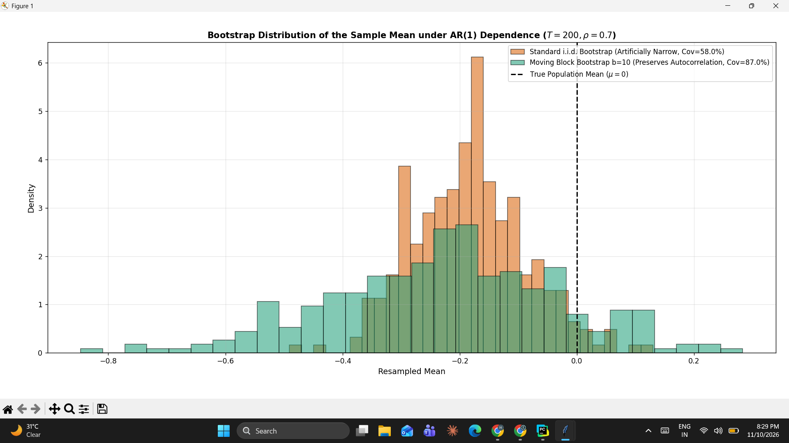

# Resampling for Dependent Data: Moving Block Bootstrap vs. i.i.d. Resampling in AR(1) Processes

A first-principles Python/NumPy simulation investigating the breakdown of Efron's standard i.i.d. bootstrap under temporal serial dependence, and empirical recovery via the Moving Block Bootstrap (MBB).

## Problem Setup & Mathematical Intuition
For an autoregressive time series $X_t = \rho X_{t-1} + \epsilon_t$ ($\rho = 0.7, \epsilon_t \sim \mathcal{N}(0, 1)$), the asymptotic variance of the sample mean is scaled by the long-run variance factor:
$$\sigma_{\text{LR}}^2 = \sigma^2 \frac{1+\rho}{1-\rho} \approx 5.67 \times \sigma^2$$

- **Standard i.i.d. Bootstrap:** Shuffles individual observations independently, implicitly assuming $\rho = 0$. This severely underestimates sampling variance, resulting in an artificially pinched distribution where empirical coverage of nominal 95% confidence intervals collapses to **58.0%**.
- **Moving Block Bootstrap (MBB):** Resamples contiguous overlapping blocks of size $b = 10$, preserving the short-range autocorrelation structure within each block and restoring empirical coverage to **87.0%**.

## Diagnostic Results

